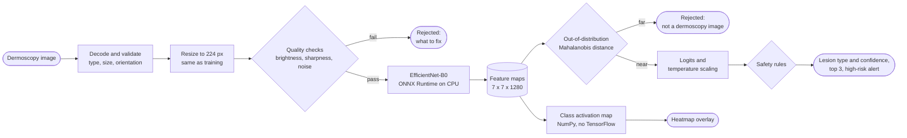
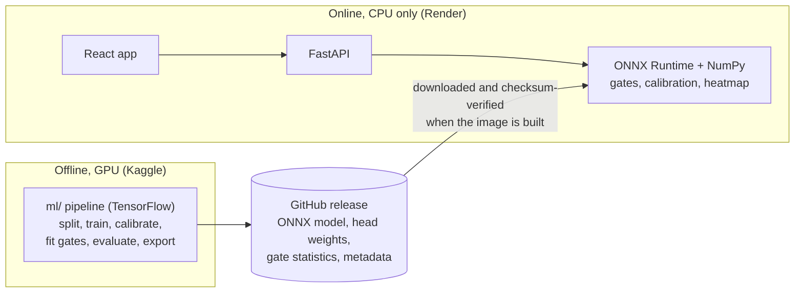
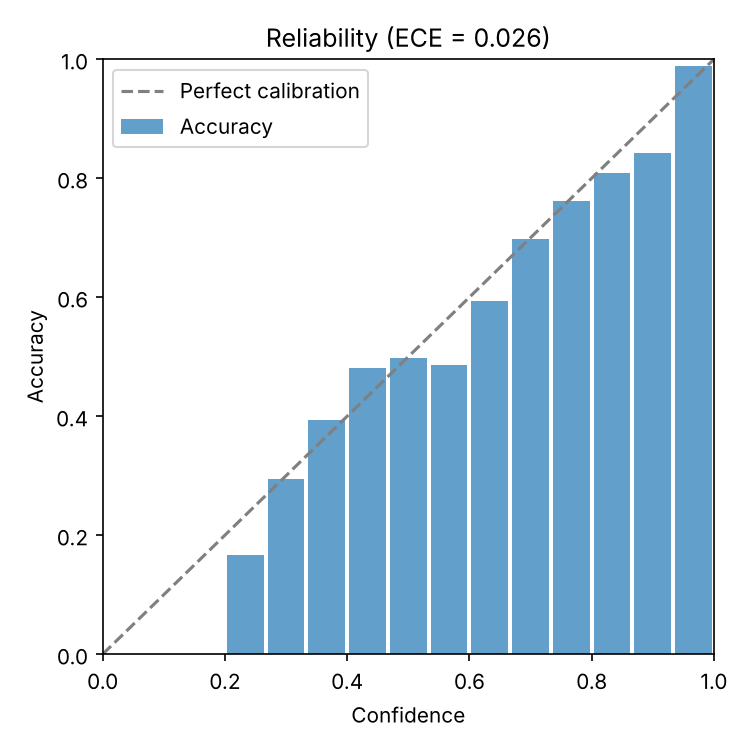
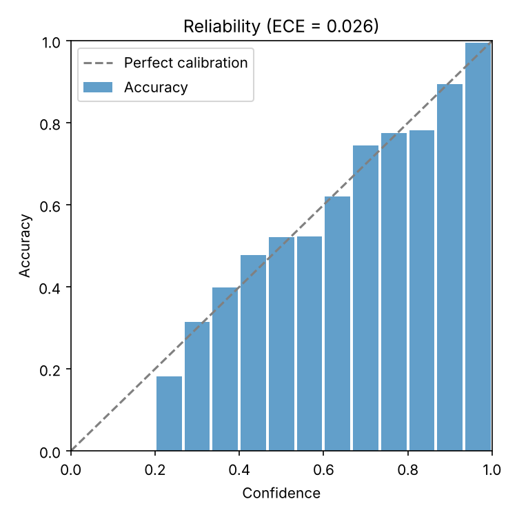
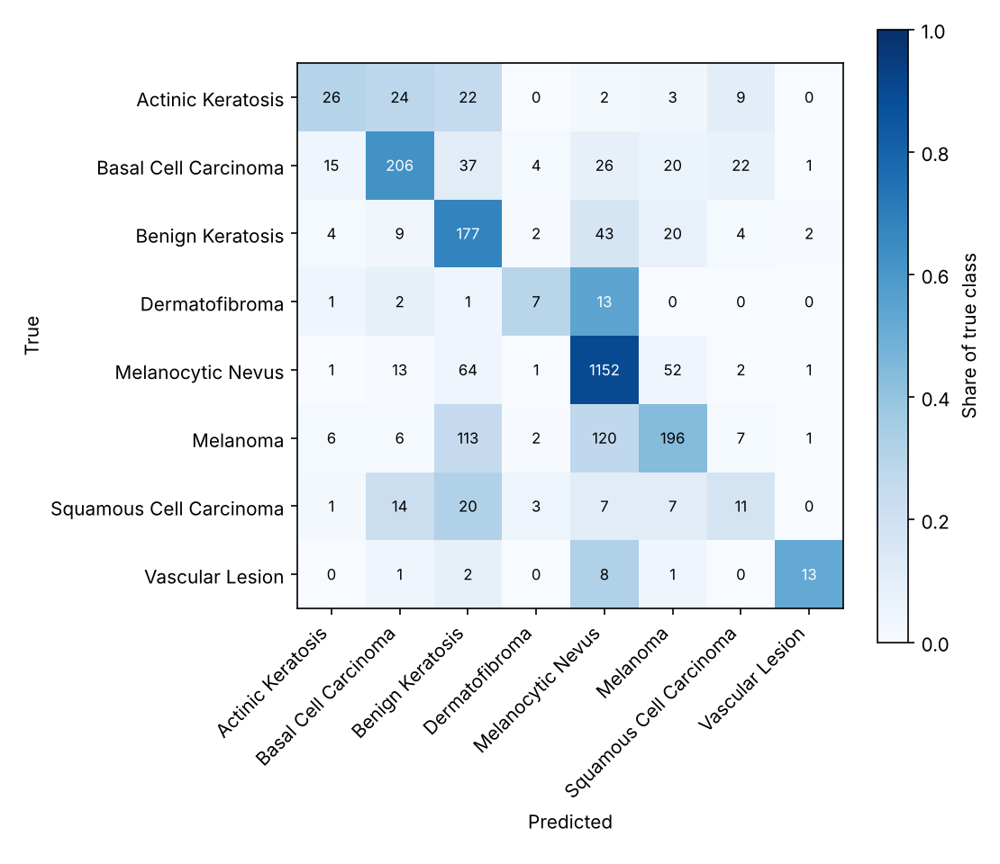
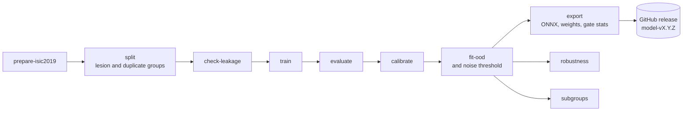

<div align="center">

# MedVision AI

**An explainable classifier for dermoscopy images of skin lesions.**

MedVision AI names the most likely of 8 lesion types in a dermoscopy image, says how sure it
is with calibrated percentages, shows where it looked, and raises a high-risk alert when the
cancer and pre-cancer types together pass a fitted line, whatever the top type is. It refuses
images it cannot judge. The clinician makes every decision.

[](https://medvision-ai-hguo.onrender.com)
[](docs/model_card.md)
[](docs/architecture.md)

[](https://github.com/OmkarJayvantJadhav/MedVisionAI/actions/workflows/ci.yml)
[](https://github.com/OmkarJayvantJadhav/MedVisionAI/actions/workflows/live.yml)


[](LICENSE)


</div>

> [!IMPORTANT]
> **Decision support, not a diagnosis and not a medical device.** MedVision AI has not been
> clinically validated. It supports a clinician's judgement and never replaces it.
> Anyone worried about a skin lesion should see a doctor.

> [!NOTE]
> The hosted app sleeps after 15 idle minutes, so the first request can take about a minute
> while it wakes up. After that, an analysis takes one to three seconds on the hosted CPU
> share (about 30 ms on a normal machine).

---

## Contents

- [Who it is for](#who-it-is-for)
- [The problem](#the-problem)
- [Objective and success criteria](#objective-and-success-criteria)
- [Scope](#scope)
- [What it does](#what-it-does)
- [Using the app](#using-the-app)
- [How it works](#how-it-works)
- [Architecture at a glance](#architecture-at-a-glance)
- [Safety by design](#safety-by-design)
- [Results](#results)
- [Engineering highlights](#engineering-highlights)
- [Tech stack](#tech-stack)
- [Quick start](#quick-start)
- [API](#api)
- [Training and evaluation](#training-and-evaluation)
- [Repository layout](#repository-layout)
- [Quality gates](#quality-gates)
- [Limitations](#limitations)
- [Roadmap](#roadmap)
- [Documentation](#documentation)
- [Acknowledgements and licence](#acknowledgements-and-licence)

---

## Who it is for

| User | Use |
|---|---|
| **Clinicians with a dermatoscope** (general practitioners, nurses, dermatologists) | A second look at a lesion: its most likely type, how sure the model is, where it looked, and whether the cancer risk is high |
| **Clinicians in training** | Comparing their own reading with the model's lesion type and heatmap |
| **Researchers and engineers** | A reproducible, documented baseline for explainable, safe skin-lesion classification |

**Not intended for the public.** Dermoscopy images need a dermatoscope, which most people do
not have; ordinary phone photos are refused by design.

## The problem

Dermoscopy images are hard to interpret, and most AI classifiers built for them are hard to
trust. Accuracy on a benchmark is usually the only number reported, but in use a typical
classifier fails quietly:

- **It answers everything.** A clinical photo, a blurry image or a picture of something else
  still gets a confident answer.
- **Its confidence means nothing.** "92%" is a raw score, not a probability.
- **One label hides the risk.** A top answer of "nevus" can sit next to a combined chance of
  cancer that is high enough to matter.
- **Accuracy hides the misses.** A headline accuracy says nothing about how many cancers are
  missed, or for whom.
- **It is a black box.** Nobody can see what the model looked at.

## Objective and success criteria

Build an **open, reproducible, explainable classifier** for dermoscopy images of a single
lesion. For each image it returns the most likely of 8 lesion types, whether it is
**confident** or **uncertain**, calibrated percentages, a heatmap and, when the cancer and
pre-cancer types together pass a fitted line, a **high-risk alert** shown above everything
else. An image it cannot judge is **not checked**, with the reason. It never makes a
diagnosis.

| # | Objective | Success criterion | Status (model-v2.2.0, test split) |
|---|---|---|---|
| 1 | **Never hide cancer risk** | The high-risk alert catches ≥ 90% of cancers and pre-cancers, with the share of lesions it is raised for reported | ✅ 0.904, raised for 49% of test images |
| 2 | **Honest confidence** | Calibration error (ECE) ≤ 0.05 | ✅ 0.026 |
| 3 | **Refuse what it cannot judge** | ≥ 99% of non-dermoscopy images rejected while ≥ 98% of lesion images pass | ✅ 99.6% rejected, 98.4% pass |
| 4 | **No silent failures** | Damaged images are rejected rather than silently misread | ✅ noise: 0% silent misses · ⚠️ JPEG quality 10: 25% |
| 5 | **Explain itself** | A heatmap for every answer, matching TensorFlow Grad-CAM (cosine ≥ 0.99) | ✅ parity test in CI |
| 6 | **Report its weaknesses** | Robustness and subgroup results regenerated by one command | ✅ `make evaluate` and the [model card](docs/model_card.md) |
| 7 | **Run anywhere** | CPU-only inference in one container under 512 MB, no external calls or API keys | ✅ about 30 ms per image, about 170 MB of memory |
| 8 | **Classify well** | Macro F1 ≥ 0.72 and melanoma top-1 recall ≥ 0.70 | ❌ 0.508 and 0.435: next on the [roadmap](#roadmap) |

The objectives are ranked. A change that improves the lesion type but lets the alert miss
more cancers, or makes the model more confident or less honest, is not accepted. Objective 8
is the weakest today: the lesion type is right about 7 times in 10, so the alert, not the
lesion type, is what catches most cancers.

## Scope

**In scope**

- **Dermoscopy images of a single skin lesion**, taken with a dermatoscope: JPEG, PNG or
  WebP, up to 8 MB.
- **Lesion type:** the most likely of the 8 ISIC 2019 types (actinic keratosis, basal cell
  carcinoma, benign keratosis, dermatofibroma, melanocytic nevus, melanoma, squamous cell
  carcinoma, vascular lesion), labelled confident or uncertain, with the top three and their
  calibrated percentages.
- **High-risk alert:** the combined chance of the cancer and pre-cancer types (melanoma,
  basal cell carcinoma, squamous cell carcinoma, actinic keratosis) against an alert line
  fitted for 90% recall.
- **Explanation:** a heatmap of where the model looked and a fixed plain-language summary.
- **Refusal:** non-dermoscopy, grainy, dark, washed-out or blurry images are not checked.
- **Anonymous, stateless use:** the image is processed in memory and discarded.

**Out of scope, by design**

| Not included | Why |
|---|---|
| Diagnosis, treatment or management advice | The lesion type is a comparison with 8 learned types, not a diagnosis |
| Self-checks by the public, ordinary phone or clinical photos | The model only learned from dermoscopy; other images are refused rather than guessed at |
| Rashes, infections, inflammatory and other non-lesion conditions | Different problem, different data |
| Rare skin cancers outside the 8 types (for example Merkel cell carcinoma) | No training data; the model cannot recognise them, so the absence of an alert never rules them out |
| Claims about clinical outcomes or referral numbers | No clinical study or primary-care data; it is not a medical device |
| Text generated by a language model | The summary restates the model's output from a fixed template, so it can never invent a claim |
| Accounts, patient records or stored images | No patient data is kept anywhere |
| Commercial use | The training data, and so the model weights, are licensed for non-commercial use only |

## What it does

| | |
|---|---|
| **Classifies** | The most likely of 8 lesion types with the top three matches, labelled confident (calibrated top percentage at or above a fitted line, where answers were right 86.9% of the time on test) or uncertain |
| **Calibrates** | Temperature scaling makes a "70%" mean right about 70% of the time (calibration error 0.026) |
| **Alerts** | A high-risk alert when the four cancer and pre-cancer types together pass a fitted line, even if a benign type ranks first; it is shown above the lesion type |
| **Rejects** | Non-dermoscopy images (out-of-distribution check), grainy images (noise check), and dark, washed-out or blurry images (quality checks) |
| **Explains** | A heatmap overlay with a strength slider, computed from the same forward pass, and a plain-language summary |
| **Respects privacy** | Images are processed in memory and never stored or logged; no accounts, no tracking, self-hosted fonts |
| **Runs on modest hardware** | EfficientNet-B0 in ONNX (16 MB) on a CPU, about 30 ms per image; one container, no external calls |

## Using the app

1. **Add a dermoscopy image.** Drop it on the card, browse your files or paste it with
   Ctrl+V. No image to hand? Pick one of the three samples (held-out ISIC 2019 test images).
2. **Watch it being checked.** The image appears straight away, with a scanning line, the
   three steps the server runs (checking the picture, comparing the lesion, marking where it
   looked) and the elapsed time. The header shows whether the system is ready.
3. **Read the result.** Its order never changes:

   | Part | When | What it shows |
   |---|---|---|
   | **High-risk alert** | The cancer and pre-cancer types together pass the alert line | Shown first, above the lesion type: consider referral to a dermatologist |
   | **Most likely lesion type** | Every checked image | The type and its percentage, labelled **Confident** or **Uncertain**, with the top three matches |
   | **Chance of cancer or pre-cancer** | Every checked image | The combined percentage against the alert line; without an alert, a reminder that this does not rule out cancer |
   | **Not checked** | A quality or out-of-distribution check failed | Instead of all of the above: what to fix ("the picture is grainy"), or that only dermoscopy images can be checked |

4. **Look closer.** A plain-language summary restates the result. On the image, a coloured
   highlight shows where the model looked; switch it off or change its strength. It is not a
   diagnosis or an outline of cancer.

The interface is one workspace card that changes with the state rather than a dashboard of
panels, with background information in collapsible sections below it. It works in light and
dark mode (following the system until you choose), by keyboard and with a screen reader, and
on a phone or tablet, where the result comes before the image.

## How it works



1. **Validate.** The upload is decoded in memory, never written to disk. Only real
   JPEG, PNG or WebP images up to 8 MB and 4096 px pass.
2. **Preprocess.** A NumPy re-implementation of TensorFlow's bilinear resize, so the
   served model sees exactly what it saw in training (covered by a parity test).
3. **Gate.** Brightness, sharpness and a sensor-noise estimate reject unusable photos.
4. **Classify.** One ONNX Runtime call returns the feature maps. The logits, the
   out-of-distribution distance and the heatmap are all derived from that one result.
5. **Decide.** Calibrated probabilities pass through the safety rules below and become the
   lesion type, its confidence label and, when needed, the high-risk alert. The response
   always carries the disclaimer and a fixed summary.

## Architecture at a glance



The two halves share nothing at runtime except a versioned, checksum-verified model
release. Components, the life of a request and the key design decisions are in
[docs/architecture.md](docs/architecture.md).

## Safety by design

Every threshold is **fitted on the validation split** and **reported on the untouched test
split**. All of them ship inside the versioned model release (`model_meta.json`).

| Rule | How it is set | Effect on the 2,527 test images |
|---|---|---|
| **High-risk alert**: melanoma + BCC + SCC + actinic keratosis probability ≥ threshold | Catch 90% of malignant validation images | **90.4%** of malignant cases alerted, precision 68.1%, alert raised for 49% of images |
| **Confident or uncertain**: top probability against a threshold | Confident lesion types must be ≥ 85% accurate on validation | 59% labelled confident, 86.9% of those correct |
| **Out-of-distribution**: Mahalanobis distance of the image features from the training images | 99% of validation images pass | 98.9% of lesions pass; **99.6%** of 497 everyday photos rejected |
| **Noise check**: sensor noise measured in the image's smoothest patches | 99% of validation images pass | Cancers missed silently on noisy photos: **49% → 0%** |
| **Quality checks**: brightness and sharpness | Fixed, conservative bounds | Black, washed-out and featureless images rejected |

The result order is deliberate. The high-risk alert is shown above the lesion type and is
raised whatever the type and however sure the model is, so a warning is never hidden behind
a benign-looking label or behind uncertainty. A rejected image gets an
explanation of *why* ("too grainy", "not a dermoscopy image") instead of a guess.

## Results

Model release [`model-v2.2.0`](https://github.com/OmkarJayvantJadhav/MedVisionAI/releases/tag/model-v2.2.0):
EfficientNet-B0 trained on ISIC 2019, evaluated on a **lesion-grouped, leakage-checked** test
split of 2,527 images. Every number here is regenerated by `make evaluate`.

<table>
<tr><td valign="top">

**Overall**

| Metric | Value |
|---|---|
| Accuracy (top-1) | 0.708 |
| Macro F1 | 0.508 |
| ROC-AUC (one-vs-rest) | 0.935 |
| Malignant-group ROC-AUC | 0.916 |
| Calibration error (ECE) | 0.026 |
| Malignant recall at the high-risk alert | **0.904** |

</td><td valign="top">

**Per class (recall)**

| Class | Recall | Test images |
|---|---|---|
| Melanocytic nevus | 0.90 | 1,286 |
| Benign keratosis | 0.68 | 261 |
| Basal cell carcinoma | 0.62 | 331 |
| Vascular lesion | 0.52 | 25 |
| Melanoma | 0.43 | 451 |
| Actinic keratosis | 0.30 | 86 |
| Dermatofibroma | 0.29 | 24 |
| Squamous cell carcinoma | 0.17 | 63 |

</td></tr>
</table>

**Robustness.** The share of malignant images missed *without any warning* under image
damage, with all checks active:

| Clean | Mild blur | Phone-like | Darker | JPEG q30 | Noise σ8 | Noise σ20 | JPEG q10 |
|---|---|---|---|---|---|---|---|
| 9.3% | 7.7% | 9.9% | 13.6% | 12.1% | **0%** | **0%** | 25.1% |

**By patient group.** High-risk alert recall: men 0.95, women 0.84, ages 30–49 0.76,
ages 70+ 0.95, lower limbs 0.82. Skin type is not recorded in ISIC 2019, so performance
on darker skin is **unknown**. The [model card](docs/model_card.md) states this plainly.

<details>
<summary><b>Calibration and confusion matrix</b></summary>
<br>

| Before temperature scaling | After |
|---|---|
|  |  |

<p align="center"></p>

</details>

## Engineering highlights

<details open>
<summary><b>Grad-CAM without TensorFlow, from the same forward pass</b></summary>

For a `pooling → dense` head, Grad-CAM's channel weights are exactly the dense layer's
weights, so the heatmap reduces to a weighted sum of the last feature maps. The ONNX
export outputs those feature maps, and the backend computes the heatmap in NumPy. That
removes TensorFlow from serving and makes an explanation nearly free. A parity test
compares the result with TensorFlow Grad-CAM (cosine similarity ≥ 0.99).
</details>

<details open>
<summary><b>Rejection gates measured by the failure that matters</b></summary>

A rejected photo is a safe outcome; a missed cancer with no warning is not. The robustness
suite therefore counts **silent misses**. That metric showed noisy photos slipping past the
out-of-distribution check and losing up to half of malignant cases. A noise estimate taken
in each image's smoothest patches, so hair and texture don't count, closed the gap
completely at a cost of 0.5% of clean images.
</details>

<details open>
<summary><b>Leakage-free splits, and the bug that almost hid it</b></summary>

16,459 of the 25,331 ISIC images belong to lesions photographed several times, so splits
are grouped by lesion and by near-duplicate image hash. The first hash mostly encoded the
dark circular border common to dermoscopy photos. It chained 3,676 unrelated images into
one "duplicate" group and skewed the test set. Hashing the centre of the image fixed it,
and `split` now refuses any group larger than 20 images.
</details>

<details>
<summary><b>More decisions worth a look</b></summary>

- **Float32 rebuild bug.** A mixed-precision model reloaded through `set_weights` silently
  lost its input normalisation (validation 0.695 → 0.646). Loading through Keras's own
  weight loader fixed it, and a regression test guards it.
- **Out-of-distribution score.** Energy and max-softmax scores were tried first, but only
  rejected 18% of everyday photos at 99% lesion acceptance. Mahalanobis distance on the
  pooled features reached AUROC 0.9998.
- **Hosting.** The app first targeted Hugging Face Docker Spaces, then moved to Render from
  a Blueprint (`render.yaml`). A daily workflow smoke-tests the public URL.
- **One card, not a dashboard.** The first interface showed the photo twice (preview and
  heatmap) across a page of boxes. One card that turns from drop zone into photo-plus-result
  keeps the answer in focus, and phones get the verdict above the photo.
- **Typed contract without TypeScript.** The frontend is plain JavaScript by choice. The
  committed OpenAPI schema keeps it honest: frontend tests validate their mocks against it,
  and a backend test fails if it goes stale.

Every decision, with its reasoning, is in the [decision log](docs/PROJECT_PLAN.md#12-decision-log).
</details>

## Tech stack

| Layer | Choices |
|---|---|
| **Model** | EfficientNet-B0 (ImageNet weights), TensorFlow / Keras 3, two-stage fine-tuning, square-root class weights, mixed precision on a Kaggle T4 GPU |
| **Export** | tf2onnx (opset 17) with two outputs, `probabilities` and `feature_maps`; dense-head weights, gate statistics and SHA-256 checksums shipped with each release |
| **Serving** | FastAPI, Pydantic v2, ONNX Runtime (CPU) and NumPy, with **no TensorFlow**; structured JSON logs, per-client rate limit, restricted CORS |
| **Frontend** | React 19 (JavaScript), Vite, Tailwind CSS v4, self-hosted fonts, Vitest |
| **Ops** | Multi-stage Docker image (non-root, health check, model verified at build), GitHub Actions CI, Render, daily live smoke test |
| **Tooling** | uv with lockfiles, ruff, mypy (strict), ESLint, Prettier, pre-commit, Make |

## Quick start

**Run the whole app** (website, API and the checksum-verified model) with Docker:

```bash
git clone https://github.com/OmkarJayvantJadhav/MedVisionAI.git
cd MedVisionAI
docker compose up --build        # open http://localhost:7860
```

**Develop locally** with [uv](https://docs.astral.sh/uv/), Node.js and GNU Make:

```bash
make setup                       # Python dependencies for ml/ and backend/, git hooks
make download-model BASE_URL=https://github.com/OmkarJayvantJadhav/MedVisionAI/releases/download/model-v2.2.0
make run                         # API on http://localhost:8000 (docs at /docs)
make frontend-setup frontend-dev # UI on http://localhost:5173, proxied to the API
make check frontend-check        # everything CI runs
make help                        # every target
```

## API

Interactive documentation is served at `/docs`. All endpoints live under `/api/v1`.

| Method | Path | Purpose |
|---|---|---|
| `GET` | `/health` | Liveness |
| `GET` | `/ready` | Model loaded and checksum-verified |
| `GET` | `/meta` | Model version, classes, fitted thresholds, disclaimer |
| `POST` | `/predict` | Prediction for one image (`multipart/form-data`, field `file`) |
| `POST` | `/explain` | Prediction plus heatmap and overlay PNGs |

```bash
curl -s -F file=@frontend/public/samples/melanoma.jpg \
  https://medvision-ai-hguo.onrender.com/api/v1/predict
```

```jsonc
{
  "status": "ok",                       // ok | low_confidence | rejected
  "predicted_class": "Melanoma",
  "confidence": 0.91,
  "top_k": [{ "class_name": "Melanoma", "probability": 0.91 }, "..."],
  "risk_flag": "malignant_suspected",   // malignant_suspected | benign | uncertain
  "malignant_probability": 0.91,
  "reasons": ["malignant_probability_above_threshold"],
  "model_version": "skin-effb0-v2.2.0",
  "calibrated": true,
  "summary": "…plain-language text…",
  "disclaimer": "Not a medical diagnosis. …"
}
```

Full reference, error codes and configuration: [docs/api.md](docs/api.md).

## Training and evaluation

Everything runs through one tested command-line tool, `medvision-ml`. The notebook only
calls it.



- **Train on Kaggle:** [`notebooks/train_kaggle.ipynb`](notebooks/train_kaggle.ipynb) runs
  the full pipeline on a Kaggle GPU in the background (*Save & Run All*). No tab has to stay open.
- **Reproduce every reported number:**
  `make evaluate MODEL=ml/artifacts/<run>/model.keras METADATA=<ISIC metadata CSV>`.
- **Data, licences and steps:** [docs/DATASETS.md](docs/DATASETS.md).

## Repository layout

```text
MedVisionAI/
├── ml/                 TensorFlow training, evaluation, calibration, gates, ONNX export
│   ├── src/medvision_ml/   data · models · training · evaluation · calibration · export
│   └── tests/              unit, pipeline and TensorFlow-vs-serving parity tests
├── backend/            FastAPI service on ONNX Runtime and NumPy (no TensorFlow)
│   └── app/                api · core · inference · services · schemas
├── frontend/           React + Vite + Tailwind web app, served by the backend in production
├── notebooks/          Kaggle notebook that runs the whole training pipeline
├── docs/               model card, architecture, API, datasets, deployment, project plan
├── Dockerfile          one image: built frontend, API and verified model
├── render.yaml         Render deployment (Blueprint)
└── Makefile            setup · check · run · evaluate · docker · smoke
```

## Quality gates

| Check | Where |
|---|---|
| ruff, mypy (strict), ESLint, Prettier | CI on every pull request |
| **266 automated tests**: 131 ml, 100 backend, 35 frontend; backend coverage 98% | CI on every pull request |
| Parity: ONNX vs Keras, NumPy heatmap vs TensorFlow Grad-CAM, served resize, out-of-distribution and noise scores | `ml` test suite |
| Docker build, then a container smoke test: ready, home page, predict, explain, non-skin and grainy images rejected, p95 latency | CI on every pull request |
| The same smoke test against the public URL | Daily and on demand ("Live site") |

## Limitations

- **Moderate lesion-type accuracy.** The most likely type is right 70.8% of the time;
  top-1 recall is low for melanoma (0.43) and squamous cell carcinoma (0.17). That is why
  the high-risk alert relies on the combined malignancy probability, not on the top type.
- **Frequent alerts.** To catch 90% of malignant lesions, the alert is raised for about
  half of the test images. ISIC 2019 is rich in cancers (37% of test images are
  malignant); in primary care, where cancers are rarer, a smaller share of alerts would be
  malignant.
- **Dermoscopy only.** Clinical and phone photos are rejected by design.
- **Eight lesion types only.** Rarer skin cancers (for example Merkel cell carcinoma or
  melanoma subtypes that are rare in the training data) may be missed;
  the absence of an alert never rules out malignancy.
- **Heavy JPEG compression** (quality 10) still causes silent misses (25%).
- **Unequal recall** for women, ages 30–49 and the lower limbs; **unknown** performance
  on darker skin.
- One dataset, no external or prospective validation. See the
  [model card](docs/model_card.md) for details.

## Roadmap

| Item | Status |
|---|---|
| Leakage-free data pipeline, training and export | ✅ Done |
| Inference API, calibration, safety and input gates | ✅ Done |
| Web app, Docker image, CI and live deployment | ✅ Done |
| Robustness and subgroup evaluation, model card | ✅ Done |
| **Stronger model**: larger backbone, higher resolution, full fine-tuning, tracked in MLflow, on a Kaggle GPU; aims to keep recall at 0.90 with fewer alerts and better lesion types | Next: objective 8 |
| **Catch heavy JPEG compression** in the input gates | Planned: objective 4 |
| External validation on another dermoscopy dataset, including darker skin | Open: needs licensed data with skin-type labels |

A new model replaces the current one only if it keeps malignant recall at 0.90 or higher.
Among those, the highest macro F1 wins, then the lowest calibration error. Accuracy alone
never decides.

## Documentation

| Document | What it covers |
|---|---|
| [Model card](docs/model_card.md) | Intended use, data, per-class results, decision rules, robustness, subgroups, limitations |
| [Architecture](docs/architecture.md) | Components, request flow, model pipeline, key design decisions |
| [API reference](docs/api.md) | Endpoints, response fields, error codes, configuration |
| [Datasets](docs/DATASETS.md) | ISIC 2019, everyday-photo set, licences, attribution, training steps |
| [Deployment](docs/deploy.md) | Render setup and the live smoke test |
| [Project plan](docs/PROJECT_PLAN.md) | Problem, objective, scope, phases, conventions and the full decision log |

## Acknowledgements and licence

- **Training data:** the [ISIC 2019 Challenge](https://challenge.isic-archive.com/data/#2019)
  dataset (CC BY-NC 4.0), drawing on HAM10000 (Tschandl et al., 2018), the ISIC 2017
  challenge (Codella et al., 2017) and BCN20000 (Combalia et al., 2019). Full citations are
  in [docs/DATASETS.md](docs/DATASETS.md).
- **Everyday photos** for the out-of-distribution report: Open Images V4 validation set
  (CC BY 2.0), downloaded with attribution by `medvision-ml fetch-non-skin`.
- **Licences:** the source code is released under the [**MIT licence**](LICENSE). The model
  weights and gate statistics are released under **CC BY-NC 4.0**, because the training data is
  non-commercial.

<div align="center">
<br>
<sub>An explainable classifier for dermoscopy images, from data to deployment.<br>
<b>Decision support, not a medical device.</b> Clinical decisions rest with the clinician.</sub>
</div>
