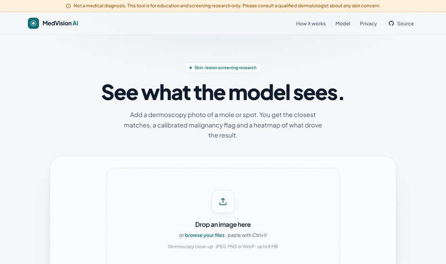
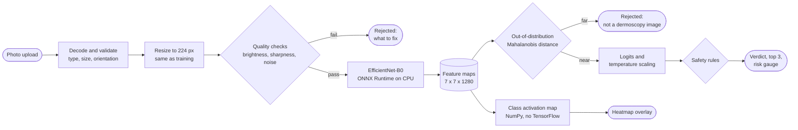
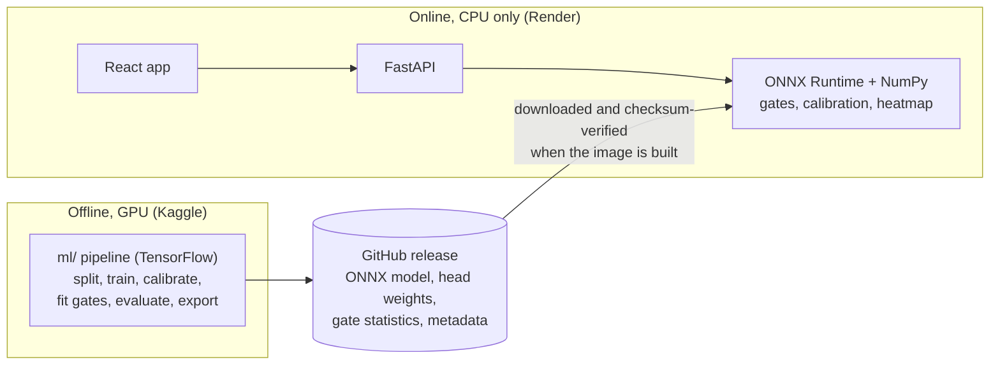
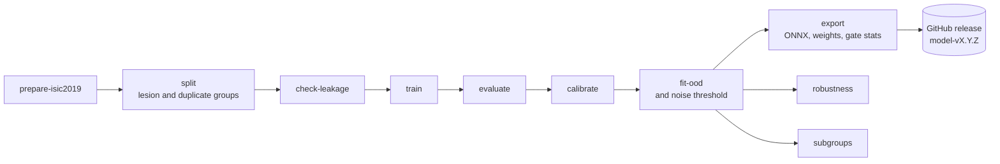

<div align="center">

# MedVision AI

**An explainable, safety-gated skin-cancer triage tool for dermoscopy images.**

Give it a dermoscopy image of a skin lesion and it answers one question: *should this
lesion be seen by a dermatologist?* It catches 9 in 10 malignant lesions at its operating
point, says how sure it is, shows where it looked, and refuses images it cannot judge.
It runs on an ordinary CPU, with no GPU and no external services.

[](https://medvision-ai-hguo.onrender.com)
[](docs/model_card.md)
[](docs/architecture.md)

[](https://github.com/OmkarJayvantJadhav/MedVisionAI/actions/workflows/ci.yml)
[](https://github.com/OmkarJayvantJadhav/MedVisionAI/actions/workflows/live.yml)


[](LICENSE)


<br>

<!-- 

<sub>Choose a photo, watch it being analysed, read the verdict, then explore the heatmap.
The sample is an ISIC 2019 test image the model never saw in training.</sub> -->

</div>

> [!IMPORTANT]
> **Not a medical device and not a diagnosis.** MedVision AI has not been clinically
> validated. It helps decide whether a lesion needs a closer look; it does not replace a
> dermatologist. Anyone worried about a skin lesion should see one.

> [!NOTE]
> The hosted app sleeps after 15 idle minutes, so the first request can take about a minute
> while it wakes up. After that, an analysis takes one to three seconds on the hosted CPU
> share (about 30 ms on a normal machine).

---

## Contents

- [The problem](#the-problem)
- [Objective and success criteria](#objective-and-success-criteria)
- [Scope](#scope)
- [Lightweight by design](#lightweight-by-design)
- [What it does](#what-it-does)
- [Using the app](#using-the-app)
- [How it works](#how-it-works)
- [Architecture at a glance](#architecture-at-a-glance)
- [Safety by design](#safety-by-design)
- [Results](#results)
- [Engineering highlights](#engineering-highlights)
- [Tech stack](#tech-stack)
- [Quick start](#quick-start)
- [API](#api)
- [Training and evaluation](#training-and-evaluation)
- [Repository layout](#repository-layout)
- [Quality gates](#quality-gates)
- [Limitations](#limitations)
- [Roadmap](#roadmap)
- [Documentation](#documentation)
- [Acknowledgements and licence](#acknowledgements-and-licence)

---

## The problem

Skin cancer is curable when it is caught early, and dermoscopy (magnified, evenly lit
close-ups of a lesion) helps clinicians catch it. Image classifiers trained on dermoscopy
can help with triage, but most published skin-lesion classifiers are not safe to put in
front of people:

- **They answer everything.** A photo of a cat or a blurry screenshot still gets a confident
  diagnosis.
- **They hide their misses.** A headline accuracy says nothing about how many cancers go
  unflagged, or for whom.
- **Their confidence means nothing.** "92%" is a raw score, not a probability.
- **They are black boxes.** Nobody can see what the model looked at.
- **They are hard to run.** Many need a GPU or a paid API, so they never leave the notebook.

## Objective and success criteria

Build an **open, reproducible triage tool** that answers one question for a dermoscopy
image, *"should this lesion be seen by a dermatologist?"*, and is honest about everything
it cannot do. It supports the decision to seek care; it never makes a diagnosis.

| # | Objective | Success criterion | Status (model-v2.2.0, test split) |
|---|---|---|---|
| 1 | **Catch cancers** | Malignant-group recall ≥ 0.90 at the operating point | ✅ 0.904 |
| 2 | **Honest confidence** | Calibration error (ECE) ≤ 0.05 | ✅ 0.026 |
| 3 | **Refuse what it cannot judge** | ≥ 99% of non-dermoscopy photos rejected while ≥ 98% of lesion images pass | ✅ 99.6% rejected, 98.4% pass |
| 4 | **No silent failures** | Damaged images are rejected rather than silently misread | ✅ noise: 0% silent misses · ⚠️ JPEG quality 10: 25% |
| 5 | **Explain itself** | A heatmap for every answer, matching TensorFlow Grad-CAM (cosine ≥ 0.99) | ✅ parity test in CI |
| 6 | **Report its weaknesses** | Robustness and subgroup results regenerated by one command | ✅ `make evaluate` and the [model card](docs/model_card.md) |
| 7 | **Run anywhere** | CPU-only inference in one container under 512 MB, no external calls or API keys | ✅ about 30 ms per image, about 170 MB of memory |
| 8 | **Classify well** | Macro F1 ≥ 0.72 and melanoma top-1 recall ≥ 0.70 | ❌ 0.508 and 0.435: next on the [roadmap](#roadmap) |

The objectives are ranked. A change that improves accuracy but lowers cancer recall, or
makes the model more confident or less honest, is not accepted.

## Scope

**In scope**

- Dermoscopy images of a **single skin lesion**: JPEG, PNG or WebP, up to 8 MB.
- The **8 ISIC 2019 categories**: actinic keratosis, basal cell carcinoma, benign keratosis,
  dermatofibroma, melanocytic nevus, melanoma, squamous cell carcinoma, vascular lesion.
- A **triage verdict** (possible malignancy, unsure, no flag, or photo not assessed), with
  calibrated scores, a heatmap and a fixed plain-language summary.
- **Anonymous** use: the image is processed in memory and discarded.

**Out of scope, by design**

| Not included | Why |
|---|---|
| Diagnosis, treatment or medical advice | Only a clinician can diagnose; the tool is not a medical device, has not been clinically validated, and says so on every screen |
| Ordinary phone photos, rashes, eczema, infections and the thousands of other skin conditions | No openly licensed, expert-labelled data at the needed scale; these photos are rejected instead of guessed at |
| Text generated by a language model | The summary restates the model's output from a fixed template, so it can never invent a claim |
| Accounts, history or stored images | No patient data is kept anywhere |
| Commercial use | The training data, and so the model weights, are licensed for non-commercial use only |

## Lightweight by design

The whole service is one container that needs no GPU, no database and no outside service:

- **Small model.** EfficientNet-B0 exported to ONNX (16 MB) on ONNX Runtime. An analysis
  takes about 30 ms on a laptop CPU, and the container uses about 170 MB of memory.
- **One forward pass does everything.** The prediction, the heatmap and the
  out-of-distribution check all come from the same model output.
- **No TensorFlow in serving.** TensorFlow is only used offline for training; the server
  runs ONNX Runtime and NumPy.
- **Private by construction.** Images are processed in memory and discarded; nothing is
  stored, logged or sent anywhere.

## What it does

| | |
|---|---|
| **Classifies** | 8 conditions from the ISIC 2019 dataset: actinic keratosis, basal cell carcinoma, benign keratosis, dermatofibroma, melanocytic nevus, melanoma, squamous cell carcinoma, vascular lesion |
| **Calibrates** | Temperature scaling makes a "70%" mean right about 70% of the time (calibration error 0.026) |
| **Flags risk** | A malignancy warning when the four cancer-related classes add up past a fitted threshold, even if a benign class ranks first |
| **Rejects** | Non-dermoscopy photos (out-of-distribution check), grainy photos (noise check), and dark, washed-out or blurry photos (quality checks) |
| **Explains** | A heatmap overlay with an opacity slider, computed from the same forward pass |
| **Respects privacy** | Images are processed in memory and never stored or logged; no accounts, no tracking, self-hosted fonts |
| **Works anywhere** | Drag and drop, paste or file picker; light and dark themes; phones and desktops; keyboard accessible |


## Using the app

1. **Add a photo.** Drop it on the card, browse your files or paste it with Ctrl+V.
   No photo to hand? Pick one of the three samples (held-out ISIC 2019 test images).
2. **Watch it being analysed.** The photo appears straight away, with a scanning line while
   the three steps run: quality check, model, heatmap.
3. **Read the verdict first.** One of four outcomes leads the result, always in this order of
   priority:

   | Verdict | When | What it tells you |
   |---|---|---|
   | **Possible malignancy** | Cancer-related classes add up past the fitted threshold | See a dermatologist and show them this spot |
   | **Unsure** | Top confidence below the fitted threshold | Try a sharper, closer photo; see a doctor if the spot changes |
   | **No malignancy flag** | Neither of the above | Nothing flagged, which does not rule anything out |
   | **Photo not assessed** | A quality or out-of-distribution check failed | What to fix ("too grainy"), or that the model only knows dermoscopy images |

4. **Look closer.** Below the verdict: the closest match, the top three with calibrated
   percentages, and the cancer-related gauge with its threshold marker. On the photo itself,
   the heatmap shows where the model looked; toggle it or change its opacity.
5. **Technical details**, folded away, show the status, risk flag, summary, model version and
   processing time.

The interface is one card that changes state rather than a page of panels. It works in light
and dark mode, by keyboard and with a screen reader, and on a phone, where the verdict comes
before the photo.

## How it works



1. **Validate.** The upload is decoded in memory, never written to disk. Only real
   JPEG, PNG or WebP images up to 8 MB and 4096 px pass.
2. **Preprocess.** A NumPy re-implementation of TensorFlow's bilinear resize, so the
   served model sees exactly what it saw in training (covered by a parity test).
3. **Gate.** Brightness, sharpness and a sensor-noise estimate reject unusable photos.
4. **Classify.** One ONNX Runtime call returns the feature maps. The logits, the
   out-of-distribution distance and the heatmap are all derived from that one result.
5. **Decide.** Calibrated probabilities pass through the safety rules below. The response
   always carries the disclaimer and a plain-language summary.

## Architecture at a glance



The two halves share nothing at runtime except a versioned, checksum-verified model
release. Components, the life of a request and the key design decisions are in
[docs/architecture.md](docs/architecture.md).

## Safety by design

Every threshold is **fitted on the validation split** and **reported on the untouched test
split**. All of them ship inside the versioned model release (`model_meta.json`).

| Rule | How it is set | Effect on the 2,527 test images |
|---|---|---|
| **Malignancy flag**: melanoma + BCC + SCC + actinic keratosis probability ≥ threshold | Catch 90% of malignant validation images | **90.4%** of malignant cases flagged, precision 68.1% |
| **Low confidence**: top probability below threshold | Confident answers must be ≥ 85% accurate on validation | 59% answered confidently, 86.9% of those correct |
| **Out-of-distribution**: Mahalanobis distance of the image features from the training images | 99% of validation images pass | 98.9% of lesions pass; **99.6%** of 497 everyday photos rejected |
| **Noise check**: sensor noise measured in the image's smoothest patches | 99% of validation images pass | Cancers missed silently on noisy photos: **49% → 0%** |
| **Quality checks**: brightness and sharpness | Fixed, conservative bounds | Black, washed-out and featureless images rejected |

The verdict order is deliberate. A malignancy warning outranks "unsure", which outranks
"no flag", so a warning is never hidden behind uncertainty. A rejected photo gets an
explanation of *why* ("too grainy", "not a dermoscopy image") instead of a guess.

## Results

Model release [`model-v2.2.0`](https://github.com/OmkarJayvantJadhav/MedVisionAI/releases/tag/model-v2.2.0):
EfficientNet-B0 trained on ISIC 2019, evaluated on a **lesion-grouped, leakage-checked** test
split of 2,527 images. Every number here is regenerated by `make evaluate`.

<table>
<tr><td valign="top">

**Overall**

| Metric | Value |
|---|---|
| Accuracy (top-1) | 0.708 |
| Macro F1 | 0.508 |
| ROC-AUC (one-vs-rest) | 0.935 |
| Malignant-group ROC-AUC | 0.916 |
| Calibration error (ECE) | 0.026 |
| Malignant recall at the flag | **0.904** |

</td><td valign="top">

**Per class (recall)**

| Class | Recall | Test images |
|---|---|---|
| Melanocytic nevus | 0.90 | 1,286 |
| Benign keratosis | 0.68 | 261 |
| Basal cell carcinoma | 0.62 | 331 |
| Vascular lesion | 0.52 | 25 |
| Melanoma | 0.43 | 451 |
| Actinic keratosis | 0.30 | 86 |
| Dermatofibroma | 0.29 | 24 |
| Squamous cell carcinoma | 0.17 | 63 |

</td></tr>
</table>

**Robustness.** The share of malignant images missed *without any warning* under image
damage, with all checks active:

| Clean | Mild blur | Phone-like | Darker | JPEG q30 | Noise σ8 | Noise σ20 | JPEG q10 |
|---|---|---|---|---|---|---|---|
| 9.3% | 7.7% | 9.9% | 13.6% | 12.1% | **0%** | **0%** | 25.1% |

**By patient group.** Malignancy-flag recall: men 0.95, women 0.84, ages 30–49 0.76,
ages 70+ 0.95, lower limbs 0.82. Skin type is not recorded in ISIC 2019, so performance
on darker skin is **unknown**. The [model card](docs/model_card.md) states this plainly.

<details>
<summary><b>Calibration and confusion matrix</b></summary>
<br>

| Before temperature scaling | After |
|---|---|
|  |  |

<p align="center"></p>

</details>

## Engineering highlights

<details open>
<summary><b>Grad-CAM without TensorFlow, from the same forward pass</b></summary>

For a `pooling → dense` head, Grad-CAM's channel weights are exactly the dense layer's
weights, so the heatmap reduces to a weighted sum of the last feature maps. The ONNX
export outputs those feature maps, and the backend computes the heatmap in NumPy. That
removes TensorFlow from serving and makes an explanation nearly free. A parity test
compares the result with TensorFlow Grad-CAM (cosine similarity ≥ 0.99).
</details>

<details open>
<summary><b>Rejection gates measured by the failure that matters</b></summary>

A rejected photo is a safe outcome; a missed cancer with no warning is not. The robustness
suite therefore counts **silent misses**. That metric showed noisy photos slipping past the
out-of-distribution check and losing up to half of malignant cases. A noise estimate taken
in each image's smoothest patches, so hair and texture don't count, closed the gap
completely at a cost of 0.5% of clean images.
</details>

<details open>
<summary><b>Leakage-free splits, and the bug that almost hid it</b></summary>

16,459 of the 25,331 ISIC images belong to lesions photographed several times, so splits
are grouped by lesion and by near-duplicate image hash. The first hash mostly encoded the
dark circular border common to dermoscopy photos. It chained 3,676 unrelated images into
one "duplicate" group and skewed the test set. Hashing the centre of the image fixed it,
and `split` now refuses any group larger than 20 images.
</details>

<details>
<summary><b>More decisions worth a look</b></summary>

- **Float32 rebuild bug.** A mixed-precision model reloaded through `set_weights` silently
  lost its input normalisation (validation 0.695 → 0.646). Loading through Keras's own
  weight loader fixed it, and a regression test guards it.
- **Out-of-distribution score.** Energy and max-softmax scores were tried first, but only
  rejected 18% of everyday photos at 99% lesion acceptance. Mahalanobis distance on the
  pooled features reached AUROC 0.9998.
- **Hosting.** The app first targeted Hugging Face Docker Spaces, then moved to Render from
  a Blueprint (`render.yaml`). A daily workflow smoke-tests the public URL.
- **One card, not a dashboard.** The first interface showed the photo twice (preview and
  heatmap) across a page of boxes. One card that turns from drop zone into photo-plus-result
  keeps the answer in focus, and phones get the verdict above the photo.
- **Typed contract without TypeScript.** The frontend is plain JavaScript by choice. The
  committed OpenAPI schema keeps it honest: frontend tests validate their mocks against it,
  and a backend test fails if it goes stale.

Every decision, with its reasoning, is in the [decision log](docs/PROJECT_PLAN.md#12-decision-log).
</details>

## Tech stack

| Layer | Choices |
|---|---|
| **Model** | EfficientNet-B0 (ImageNet weights), TensorFlow / Keras 3, two-stage fine-tuning, square-root class weights, mixed precision on a Kaggle T4 GPU |
| **Export** | tf2onnx (opset 17) with two outputs, `probabilities` and `feature_maps`; dense-head weights, gate statistics and SHA-256 checksums shipped with each release |
| **Serving** | FastAPI, Pydantic v2, ONNX Runtime (CPU) and NumPy, with **no TensorFlow**; structured JSON logs, per-client rate limit, restricted CORS |
| **Frontend** | React 19 (JavaScript), Vite, Tailwind CSS v4, self-hosted fonts, Vitest |
| **Ops** | Multi-stage Docker image (non-root, health check, model verified at build), GitHub Actions CI, Render, daily live smoke test |
| **Tooling** | uv with lockfiles, ruff, mypy (strict), ESLint, Prettier, pre-commit, Make |

## Quick start

**Run the whole app** (website, API and the checksum-verified model) with Docker:

```bash
git clone https://github.com/OmkarJayvantJadhav/MedVisionAI.git
cd MedVisionAI
docker compose up --build        # open http://localhost:7860
```

**Develop locally** with [uv](https://docs.astral.sh/uv/), Node.js and GNU Make:

```bash
make setup                       # Python dependencies for ml/ and backend/, git hooks
make download-model BASE_URL=https://github.com/OmkarJayvantJadhav/MedVisionAI/releases/download/model-v2.2.0
make run                         # API on http://localhost:8000 (docs at /docs)
make frontend-setup frontend-dev # UI on http://localhost:5173, proxied to the API
make check frontend-check        # everything CI runs
make help                        # every target
```

## API

Interactive documentation is served at `/docs`. All endpoints live under `/api/v1`.

| Method | Path | Purpose |
|---|---|---|
| `GET` | `/health` | Liveness |
| `GET` | `/ready` | Model loaded and checksum-verified |
| `GET` | `/meta` | Model version, classes, fitted thresholds, disclaimer |
| `POST` | `/predict` | Prediction for one image (`multipart/form-data`, field `file`) |
| `POST` | `/explain` | Prediction plus heatmap and overlay PNGs |

```bash
curl -s -F file=@frontend/public/samples/melanoma.jpg \
  https://medvision-ai-hguo.onrender.com/api/v1/predict
```

```jsonc
{
  "status": "ok",                       // ok | low_confidence | rejected
  "predicted_class": "Melanoma",
  "confidence": 0.91,
  "top_k": [{ "class_name": "Melanoma", "probability": 0.91 }, "..."],
  "risk_flag": "malignant_suspected",   // malignant_suspected | benign | uncertain
  "malignant_probability": 0.91,
  "reasons": ["malignant_probability_above_threshold"],
  "model_version": "skin-effb0-v2.2.0",
  "calibrated": true,
  "summary": "…plain-language text…",
  "disclaimer": "Not a medical diagnosis. …"
}
```

Full reference, error codes and configuration: [docs/api.md](docs/api.md).

## Training and evaluation

Everything runs through one tested command-line tool, `medvision-ml`. The notebook only
calls it.



- **Train on Kaggle:** [`notebooks/train_kaggle.ipynb`](notebooks/train_kaggle.ipynb) runs
  the full pipeline on a Kaggle GPU in the background (*Save & Run All*). No tab has to stay open.
- **Reproduce every reported number:**
  `make evaluate MODEL=ml/artifacts/<run>/model.keras METADATA=<ISIC metadata CSV>`.
- **Data, licences and steps:** [docs/DATASETS.md](docs/DATASETS.md).

## Repository layout

```text
MedVisionAI/
├── ml/                 TensorFlow training, evaluation, calibration, gates, ONNX export
│   ├── src/medvision_ml/   data · models · training · evaluation · calibration · export
│   └── tests/              unit, pipeline and TensorFlow-vs-serving parity tests
├── backend/            FastAPI service on ONNX Runtime and NumPy (no TensorFlow)
│   └── app/                api · core · inference · services · schemas
├── frontend/           React + Vite + Tailwind web app, served by the backend in production
├── notebooks/          Kaggle notebook that runs the whole training pipeline
├── docs/               model card, architecture, API, datasets, deployment, project plan
├── Dockerfile          one image: built frontend, API and verified model
├── render.yaml         Render deployment (Blueprint)
└── Makefile            setup · check · run · evaluate · docker · smoke
```

## Quality gates

| Check | Where |
|---|---|
| ruff, mypy (strict), ESLint, Prettier | CI on every pull request |
| **266 automated tests**: 131 ml, 100 backend, 35 frontend; backend coverage 98% | CI on every pull request |
| Parity: ONNX vs Keras, NumPy heatmap vs TensorFlow Grad-CAM, served resize, out-of-distribution and noise scores | `ml` test suite |
| Docker build, then a container smoke test: ready, home page, predict, explain, non-skin and grainy images rejected, p95 latency | CI on every pull request |
| The same smoke test against the public URL | Daily and on demand ("Live site") |

## Limitations

- **Moderate accuracy.** Top-1 recall is low for melanoma (0.43) and squamous cell
  carcinoma (0.17). That is why safety relies on the combined malignancy flag, which
  flags about half of all images.
- **Dermoscopy only.** Ordinary phone photos are rejected by design.
- **Heavy JPEG compression** (quality 10) still causes silent misses (25%).
- **Unequal recall** for women, ages 30–49 and the lower limbs; **unknown** performance
  on darker skin.
- One dataset, no external or prospective validation. See the
  [model card](docs/model_card.md) for details.

## Roadmap

| Item | Status |
|---|---|
| Leakage-free data pipeline, training and export | ✅ Done |
| Inference API, calibration, safety and input gates | ✅ Done |
| Web app, Docker image, CI and live deployment | ✅ Done |
| Robustness and subgroup evaluation, model card | ✅ Done |
| **Stronger model**: larger backbone, higher resolution, full fine-tuning, tracked in MLflow, on a Kaggle GPU | Next: objective 8 |
| **Catch heavy JPEG compression** in the input gates | Planned: objective 4 |
| External validation on darker skin tones | Open: needs licensed dermoscopy data with skin-type labels |

A new model replaces the current one only if it keeps malignant recall at 0.90 or higher.
Among those, the highest macro F1 wins, then the lowest calibration error. Accuracy alone
never decides.

## Documentation

| Document | What it covers |
|---|---|
| [Model card](docs/model_card.md) | Intended use, data, per-class results, decision rules, robustness, subgroups, limitations |
| [Architecture](docs/architecture.md) | Components, request flow, model pipeline, key design decisions |
| [API reference](docs/api.md) | Endpoints, response fields, error codes, configuration |
| [Datasets](docs/DATASETS.md) | ISIC 2019, everyday-photo set, licences, attribution, training steps |
| [Deployment](docs/deploy.md) | Render setup and the live smoke test |
| [Project plan](docs/PROJECT_PLAN.md) | Problem, objective, scope, phases, conventions and the full decision log |

## Acknowledgements and licence

- **Training data:** the [ISIC 2019 Challenge](https://challenge.isic-archive.com/data/#2019)
  dataset (CC BY-NC 4.0), drawing on HAM10000 (Tschandl et al., 2018), the ISIC 2017
  challenge (Codella et al., 2017) and BCN20000 (Combalia et al., 2019). Full citations are
  in [docs/DATASETS.md](docs/DATASETS.md).
- **Everyday photos** for the out-of-distribution report: Open Images V4 validation set
  (CC BY 2.0), downloaded with attribution by `medvision-ml fetch-non-skin`.
- **Licences:** the source code is released under the [**MIT licence**](LICENSE). The model
  weights and gate statistics are released under **CC BY-NC 4.0**, because the training data is
  non-commercial.

<div align="center">
<br>
<sub>Explainable, safety-gated skin-cancer triage, from data to deployment.<br>
<b>Not a medical device.</b> Always consult a qualified dermatologist.</sub>
</div>
