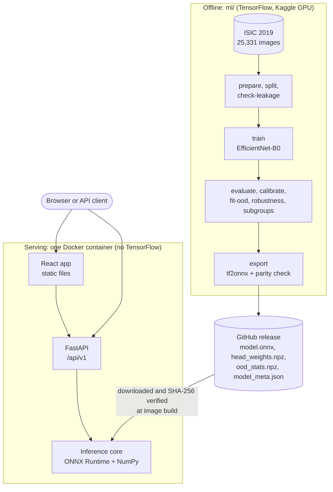
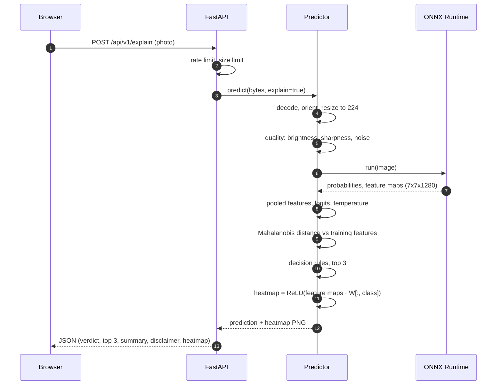
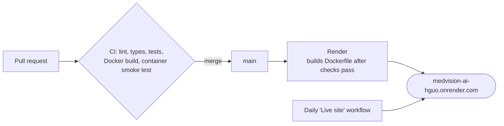

# Architecture

MedVision AI is a skin-cancer referral check for dermoscopy images, used by clinicians with
a dermatoscope. Its job is to answer *"should this lesion be referred to a dermatologist?"*
honestly, and to refuse images it cannot judge (users, objective and scope:
[PROJECT_PLAN.md §1](PROJECT_PLAN.md#1-problem-objective-and-scope)).
Every part of the design follows from two constraints: **safety first**, and **inference
on a small CPU** with no GPU or outside service.

The system has two halves that share nothing at runtime:

- **`ml/`**, an offline TensorFlow pipeline that trains, evaluates, calibrates and exports
  a model release;
- **one container** (FastAPI, ONNX Runtime, NumPy and the built React app) that serves it.

A versioned, checksum-verified GitHub release is the only thing passed between them.



## Serving

### Components

| Module | Responsibility |
|---|---|
| `app/main.py` | App factory: settings, logging, rate limit, CORS, routers, static frontend. Loads the model once in the lifespan hook; if loading fails the process still starts, `/health` stays 200 and the model endpoints return 503 |
| `app/api/v1/routes.py` | `/health`, `/ready`, `/meta`, `/predict`, `/explain`; upload size check before decoding |
| `app/core/` | `pydantic-settings` configuration (`MEDVISION_*`), JSON request logs without image content, error-code mapping, sliding-window rate limiter |
| `app/inference/artifacts.py` | Reads `model_meta.json`, verifies every listed file's SHA-256, validates shapes |
| `app/inference/preprocessing.py` | Pillow decode with format check and EXIF orientation; NumPy port of TensorFlow's bilinear resize |
| `app/inference/quality.py` | Brightness, sharpness (Laplacian variance) and the sensor-noise estimate |
| `app/inference/predictor.py` | One ONNX Runtime session; turns one forward pass into the prediction and, on request, the heatmap |
| `app/inference/calibration.py` | Logits from pooled features, temperature-scaled softmax, Mahalanobis distance |
| `app/inference/decision.py` | The safety rules: rejection reasons, low confidence, malignancy (referral) flag, risk flag |
| `app/inference/cam.py` | Class activation map, colour map, overlay, fast PNG encoding |
| `app/services/summary.py` | Summary for the clinician from a fixed template that only restates the prediction; no generated text |

### Frontend

A React (JavaScript) single-page app built by Vite and served as static files by the same
FastAPI process. Tailwind CSS v4 provides the design tokens (`src/index.css`): a medical-blue
accent, semantic colours for each referral answer, and light and dark themes that follow the
system until the viewer picks one. Every text colour meets WCAG AA contrast in both themes.

| Module | Responsibility |
|---|---|
| `src/App.jsx` | State machine of the workspace card: empty, analysing, result or error. Analyses as soon as an image is chosen, dropped or pasted; turns the `/meta` request into the readiness shown in the header and retries it while the model starts |
| `src/components/TopBar.jsx`, `ServiceStatus.jsx`, `ThemeToggle.jsx` | Branding, model readiness (from `/meta`, which answers only once the model is verified) and the light/dark switch |
| `src/components/UploadPanel.jsx` | Drop zone, file picker, accepted formats and size limit, the dermoscopy-only notice and the three samples. No camera capture, so ordinary phone photos are not encouraged |
| `src/components/AnalysisPanel.jsx` | The three server-side steps, an indeterminate progress bar and the real elapsed time. It never ticks a step off, because one request runs all three |
| `src/components/HeatmapViewer.jsx` | The selected image, the scanning line while busy, then the heatmap from the response with toggle, opacity, colour scale and a note that it shows model attention, not a diagnosis |
| `src/components/ResultCard.jsx` | Referral decision first (refer, unsure, no flag, not assessed), clinical summary, malignancy gauge with the referral threshold, closest class and top 3, model version, processing time, technical details, disclaimer |
| `src/components/InfoSections.jsx` | Collapsible sections: how it works, model facts from `/meta`, privacy, performance and limitations |
| `src/lib/labels.js` | Referral answer priority and the wording for every outcome, reason and error |
| `src/lib/modelResults.js` | Published test results keyed by model version; shown only when `/meta` reports that exact version |
| `src/api/client.js` | `fetch` wrapper; tests check mock responses against the committed `openapi.json` |

### One request



The browser draws the heatmap PNG over the user's own photo, so the opacity slider needs
no further requests. The image exists only in memory for the duration of the request.

### Decision rules

Applied in this order (`decision.py`):

1. **Reject** if the image is too dark or too bright, too blurry, too noisy, or too far
   from the training images (out of distribution). The response lists every reason.
2. **Low confidence** if the top calibrated probability is below the fitted threshold.
3. **Referral flag** if melanoma + basal cell carcinoma + squamous cell carcinoma +
   actinic keratosis reach the fitted threshold, whatever the top class is.

The interface turns these into one referral answer, ranked refer, then unsure, then no
flag, so a warning is never hidden behind "unsure".

## Offline pipeline

Every step is a subcommand of one tested CLI, `medvision-ml`. The Kaggle notebook only
calls it.

| Command | Output |
|---|---|
| `prepare-isic2019` | Class folders plus `groups.csv` (ISIC lesion IDs) |
| `split` | 80/10/10 per class, grouped by lesion and near-duplicate hash; exact copies and conflicting labels removed |
| `check-leakage` | Fails if any image, near-duplicate or lesion crosses splits |
| `train` | Two-stage fine-tuning, square-root class weights, mixed precision on GPU |
| `evaluate` | Metrics, per-class report, confusion matrix, reliability diagram |
| `calibrate` | Temperature, malignancy and low-confidence thresholds (fitted on Validation, reported on Test) |
| `fetch-non-skin` | 500 attributed CC BY 2.0 everyday photos for the out-of-distribution report |
| `fit-ood` | Feature mean and precision, distance threshold, noise threshold |
| `robustness`, `subgroups` | Results under 12 image corruptions, and by sex, age and body site |
| `export` | ONNX graph, head weights, gate statistics, `model_meta.json` with checksums; fails if ONNX and Keras disagree by more than 1e-4 |

`make evaluate` runs the reporting steps in order, and the model card quotes only its
output.

## Three decisions worth explaining

### 1. Grad-CAM as CAM, in NumPy, from the same forward pass

The classifier head is `global average pooling → dropout → dense`. For that head, the
Grad-CAM weight of feature channel *k* for class *c* is the dense kernel entry `W[k, c]`
divided by a constant. Grad-CAM therefore reduces to the original class activation map:

```
heatmap_c = ReLU( Σ_k W[k, c] · A_k )
```

Here `A` is the 7×7×1280 feature map. The ONNX export outputs `A` next to the
probabilities, and the release ships `W`. The backend recomputes the logits, the heatmap
and the out-of-distribution features from that one output.

- **Gain:** no TensorFlow, and no gradients, in serving. An explanation costs a matrix
  product instead of a backward pass.
- **Cost:** the shortcut only holds for this head shape. A parity test in `ml/` fails the
  build if the NumPy heatmap ever drifts from TensorFlow Grad-CAM (cosine similarity
  below 0.99).

### 2. Safety gates judged by silent misses

Rejecting a photo is safe, because the user is told it cannot be assessed. Answering a
malignant lesion with "no flag" is not. The robustness suite therefore measures **silent
misses**: malignant images that pass every gate but are not flagged.

- **Finding a gap:** that metric showed Gaussian noise slipping past the
  out-of-distribution gate. 30% (σ = 8) to 49% (σ = 20) of malignant images were
  missed without warning.
- **First attempt:** a whole-image noise estimate could not separate noise from hair and
  pigment texture.
- **Fix:** estimating noise in each image's smoothest 8×8 blocks did. Both thresholds are
  fitted so that 99% of validation images pass, and silent misses under noise dropped
  to 0%, at a cost of 0.5% of clean images.

### 3. Leakage-free splits, and the hash that broke them

ISIC 2019 contains many photos of the same lesion, so the split groups images by lesion
ID and by near-duplicate perceptual hash.

- **The bug:** the first hash covered the whole frame. Dermoscopy images share a dark
  circular vignette, so the hash mostly encoded the border. Within 4 bits it chained
  3,676 unrelated images of all eight classes into one "duplicate" group, which landed
  entirely in training. The test set ended up 71% nevus, with half the expected melanomas.
- **The fix:** a 256-bit hash of the central 60% of the image, a threshold checked by eye
  against real duplicates, and a guard that stops `split` when any group exceeds 20
  images. Every number from before the fix was declared void.

The [decision log](PROJECT_PLAN.md#12-decision-log) records these and every other choice
with its reasoning.

## Deployment



- The image is a multi-stage build: Node builds the frontend, then a slim Python runtime
  with uv-synced dependencies. It runs as non-root uid 1000, and the model is downloaded
  and verified at build time.
- On Render's small CPU share the container uses one inference thread
  (`MEDVISION_INFERENCE_THREADS=1`) and a shared rate limit of 60 requests a minute.
- The smoke test checks readiness, the home page, `/predict` and `/explain`. It also
  checks that a generated non-skin image and a grainy image are rejected, and reports
  p95 latency. See [deploy.md](deploy.md).

## Designed for a small CPU

| Constraint | Design choice |
|---|---|
| The host has no GPU and a fraction of one CPU | EfficientNet-B0 exported to ONNX (16 MB) on ONNX Runtime; one inference thread on Render |
| 512 MB of memory | No TensorFlow in the image; the container uses about 170 MB |
| One forward pass must do everything | Logits, the heatmap and the out-of-distribution distance all come from the same `feature_maps` output |
| The service sleeps after 15 idle minutes | The model files are baked into the image, so waking up needs no download; the model loads once at startup |
| No database or storage | Stateless requests; images live in memory only; model files come from GitHub Releases |
| No API keys | No external calls at all; fonts are self-hosted |
| GPU time is limited (about 30 hours a week on Kaggle) | Training runs as a background Kaggle notebook that only calls the tested CLI |

What it deliberately does not do (self-checks by the public, phone photos, other skin
conditions, generated text, accounts) is listed with reasons in the plan's
[scope table](PROJECT_PLAN.md#scope).
