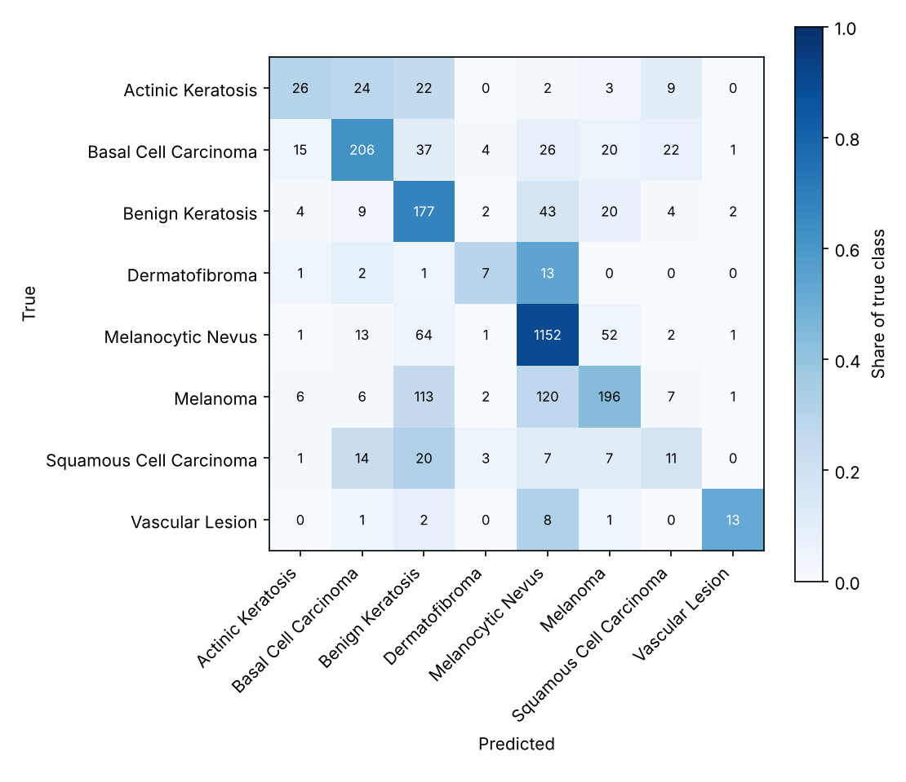
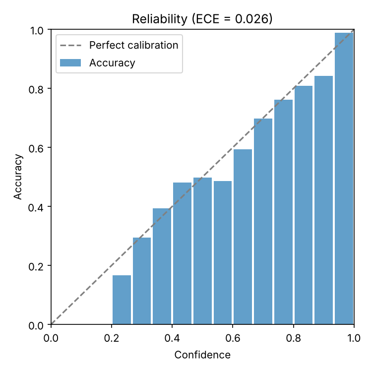
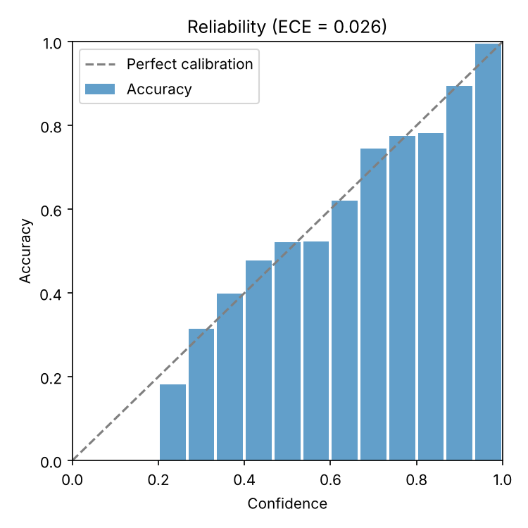

# Model card: skin-effb0-v2.2.0

Skin-lesion classifier served by the MedVision AI demo. Release
[`model-v2.2.0`](https://github.com/OmkarJayvantJadhav/MedVisionAI/releases/tag/model-v2.2.0).

> **Not a medical device and not a diagnosis.** For education and screening
> research only. Anyone worried about a skin lesion should see a dermatologist.

Every number below comes from the held-out test split and is regenerated by
`make evaluate MODEL=... METADATA=...` (see [DATASETS.md](DATASETS.md)).

## Model details

| | |
|---|---|
| Architecture | EfficientNet-B0 (ImageNet weights) → global average pooling → dropout 0.3 → dense layer with 8 outputs |
| Input | 224 × 224 RGB, raw 0–255 pixels, bilinear resize |
| Training | Two stages: head only, then the last 40 backbone layers fine-tuned; square-root class weights; mixed precision on a Kaggle T4 GPU ([notebook](../notebooks/train_kaggle.ipynb)) |
| Serving | ONNX Runtime on CPU, no TensorFlow. One forward pass gives the probabilities, the heatmap (class activation map) and the out-of-distribution score |
| Calibration | Temperature scaling, T = 1.080, fitted on the validation split |
| Licence | CC BY-NC 4.0, because the training data is CC BY-NC |
| Version history | `v2.0.0`: first ISIC 2019 model. `v2.1.0`: same weights, adds the out-of-distribution gate. `v2.2.0`: same weights, adds the noise check |

## Intended use

- **Intended:** a research prototype of a skin-cancer triage aid for
  dermoscopy images, answering *"should this lesion be seen by a
  dermatologist?"*; a public demonstration of an explainable, safety-gated
  classifier; and teaching material on responsible machine learning in health.
- **Users:** students, engineers and researchers exploring the demo or the code.
- **Out of scope:** diagnosis, triage of real patients or any clinical
  decision; use without a clinician; ordinary phone photos (the model only learned from dermoscopy
  images); conditions outside the eight classes, such as rashes, infections or
  acne; commercial use (the licence forbids it).

## Training data

The [ISIC 2019](https://challenge.isic-archive.com/data/#2019) training release:
dermoscopy images labelled by experts, CC BY-NC 4.0 (attribution in
[DATASETS.md](DATASETS.md)). After removing 48 duplicate copies and 4 images
filed under two diagnoses, 25,279 images were split 80/10/10 per class:

- 20,224 for training;
- 2,528 for validation, which fits the temperature and all thresholds;
- 2,527 for test, used only for the numbers below.

Images of the same lesion and near-duplicate photos always stay in one split,
and `medvision-ml check-leakage` confirms no image or lesion crosses splits.

The data is imbalanced: 51% of test images are melanocytic nevi, and
dermatofibroma and vascular lesion have about 25 test images each.

## Performance (test split, 2,527 images)

| Metric | Value |
|---|---|
| Accuracy (top-1) | 0.708 |
| Macro F1 | 0.508 |
| Macro precision / recall | 0.553 / 0.490 |
| ROC-AUC, one-vs-rest macro | 0.935 |
| Malignant group ROC-AUC | 0.916 |

| Class | Precision | Recall | F1 | Test images |
|---|---|---|---|---|
| Actinic Keratosis | 0.48 | 0.30 | 0.37 | 86 |
| Basal Cell Carcinoma | 0.75 | 0.62 | 0.68 | 331 |
| Benign Keratosis | 0.41 | 0.68 | 0.51 | 261 |
| Dermatofibroma | 0.37 | 0.29 | 0.33 | 24 |
| Melanocytic Nevus | 0.84 | 0.90 | 0.87 | 1,286 |
| Melanoma | 0.66 | 0.43 | 0.52 | 451 |
| Squamous Cell Carcinoma | 0.20 | 0.17 | 0.19 | 63 |
| Vascular Lesion | 0.72 | 0.52 | 0.60 | 25 |



The top-1 answer misses most melanomas: 120 of 451 are called nevus and 113
benign keratosis. The app does not rely on the top-1 answer for safety (next
section).

## Decision rules and their measured effect

All thresholds were fitted on the validation split and are shipped in
`model_meta.json`.

| Rule | Threshold | Effect on the test split |
|---|---|---|
| **Malignancy flag**: the summed probability of melanoma, basal cell carcinoma, squamous cell carcinoma and actinic keratosis reaches the threshold, whatever the top answer | 0.193, set for 90% malignant recall on validation | Recall **0.904**, precision 0.681. 49% of all images are flagged |
| **Low confidence**: top probability below the threshold | 0.625, set for 85% accuracy on confident answers | 59% of images answered confidently, at 86.9% accuracy |
| **Out-of-distribution rejection**: squared Mahalanobis distance of the image features from the training images above the threshold | 4,411, set so 99% of validation images pass | 98.9% of test lesions pass. 99.6% of 497 everyday photos ([Open Images](https://storage.googleapis.com/openimages/web/index.html), CC BY 2.0) are rejected |
| **Noise check**: estimated sensor noise of the resized image, measured in its smoothest patches so hair and texture do not count | 2.44, set so 99% of validation images pass | 99.5% of test lesions pass; noisy images are rejected (see Robustness). With both checks 98.4% of test lesions pass |
| **Quality checks**: brightness and sharpness | brightness 20–235, sharpness ≥ 5 | Rejects black, washed-out or featureless images |

Calibration error (ECE, 15 bins) is 0.026 on the test split. Before and after
temperature scaling:

| Before | After |
|---|---|
|  |  |

## Robustness

Each condition is applied to the resized test images and scored with the
shipped rules (`medvision-ml robustness`). *Missed silently* means a malignant
image that passes the out-of-distribution and noise checks but that the
malignancy flag misses.
A rejected image is a safe outcome, because the user is told that the photo
cannot be assessed.

| Condition | Accuracy | Macro F1 | Malignant recall | Malignant missed silently | Images accepted by the checks |
|---|---|---|---|---|---|
| Clean | 0.708 | 0.508 | 0.904 | 0.093 | 0.984 |
| Blur, sigma 1 px | 0.703 | 0.526 | 0.914 | 0.077 | 0.941 |
| Blur, sigma 2 px | 0.622 | 0.388 | 0.838 | 0.000 | 0.029 |
| Brightness × 0.6 | 0.657 | 0.429 | 0.860 | 0.136 | 0.986 |
| Brightness × 1.4 | 0.668 | 0.461 | 0.904 | 0.095 | 0.961 |
| JPEG quality 30 | 0.669 | 0.436 | 0.874 | 0.121 | 0.975 |
| JPEG quality 10 | 0.599 | 0.307 | 0.729 | 0.251 | 0.915 |
| Gaussian noise, std 8 | 0.631 | 0.342 | 0.692 | 0.000 | 0.003 |
| Gaussian noise, std 20 | 0.578 | 0.214 | 0.492 | 0.000 | 0.000 |
| Rotation 45° | 0.641 | 0.415 | 0.809 | 0.128 | 0.517 |
| Rotation 90° | 0.700 | 0.508 | 0.919 | 0.077 | 0.979 |
| Phone-like (half resolution, warm cast, JPEG 60) | 0.691 | 0.484 | 0.898 | 0.099 | 0.965 |

- **Holds up:** mild blur, 90° rotation and the phone-like mix change the
  results little.
- **Caught by the checks:** heavy blur and added noise are rejected almost
  entirely. Before the noise check (v2.1.0), noisy images passed and 30% (std 8)
  to 49% (std 20) of malignant ones were missed without warning; now none are.
- **Main remaining weakness, heavy JPEG compression:** at quality 10 the checks
  still accept 92% of images and a quarter of malignant ones are missed without
  warning.

## Results by patient group

ISIC 2019 records sex, approximate age and body site
(`medvision-ml subgroups`). Malignancy-flag recall at the shipped threshold:

| Group | Test images | Malignant | Accuracy | Malignant recall | Malignant precision |
|---|---|---|---|---|---|
| Female | 1,092 | 360 | 0.697 | **0.844** | 0.619 |
| Male | 1,355 | 540 | 0.714 | 0.950 | 0.731 |
| Age under 30 | 129 | 11 | 0.860 | too few | 0.265 |
| Age 30–49 | 690 | 116 | 0.799 | **0.759** | 0.458 |
| Age 50–69 | 948 | 338 | 0.695 | 0.905 | 0.689 |
| Age 70 and over | 671 | 434 | 0.598 | 0.954 | 0.793 |
| Head and neck | 371 | 271 | 0.491 | 0.941 | 0.828 |
| Lower extremity | 479 | 126 | 0.749 | **0.817** | 0.648 |
| Upper extremity | 294 | 148 | 0.650 | 0.912 | 0.780 |
| Anterior torso | 434 | 181 | 0.712 | 0.923 | 0.676 |
| Posterior torso | 423 | 149 | 0.761 | 0.919 | 0.640 |

The flag misses more malignant lesions in women (84%) than in men (95%), in
people aged 30–49 (76%), and on the legs (82%). These groups overlap, because
melanoma on the legs is more common in women. Groups with fewer than 20
malignant images report no recall.

**Skin type is not recorded in ISIC 2019, so performance on darker skin is
unknown.** Public dermoscopy collections, ISIC included, come mostly from
patients with light skin, so lower performance on darker skin should be assumed
until it is measured.

## Limitations

- Low top-1 recall on melanoma (0.43) and squamous cell carcinoma (0.17); rare
  classes have few test images, so their numbers are uncertain.
- About half of all images get the malignancy flag. This is the price of
  catching 90% of malignant cases with this model.
- Dermoscopy only: other photos are rejected, which is intended.
- Heavy JPEG compression causes silent misses (see Robustness).
- Recall gaps by sex, age and body site, and unknown performance by skin type.
- Evaluated on one dataset only; no external or prospective validation.

## Ethical considerations

- The interface leads with what to do next and never presents a diagnosis.
  Every response carries the disclaimer, and the heatmap is labelled as
  showing where the model looked, not evidence.
- The thresholds favour flagging over reassurance, so false alarms are
  common. A false reassurance can delay care, which is worse.
- Uploaded images are processed in memory, never stored or logged, and there
  are no accounts or tracking.

## Reproduce

```bash
make evaluate MODEL=ml/artifacts/<run>/model.keras METADATA=<ISIC_2019_Training_Metadata.csv>
```

This needs the prepared ISIC 2019 splits (see [DATASETS.md](DATASETS.md)). It
writes `ml/outputs/{evaluation,calibration,ood,robustness,subgroups}/<run>/`.
